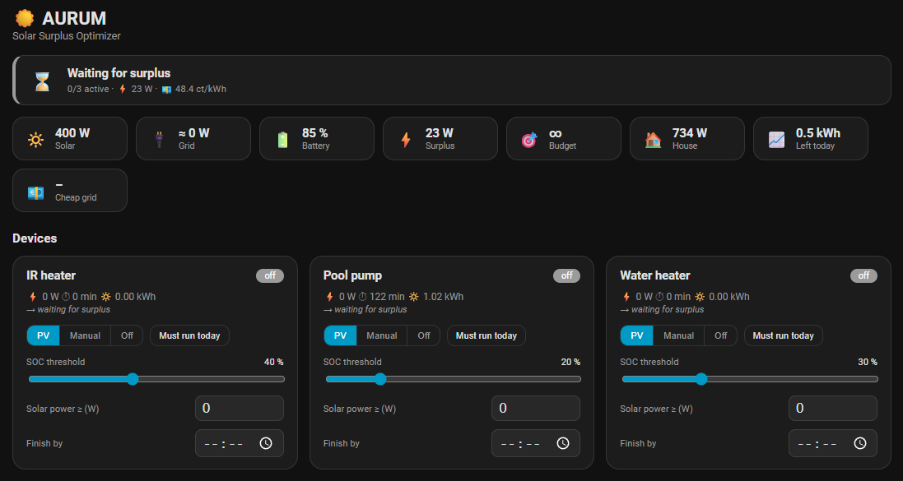
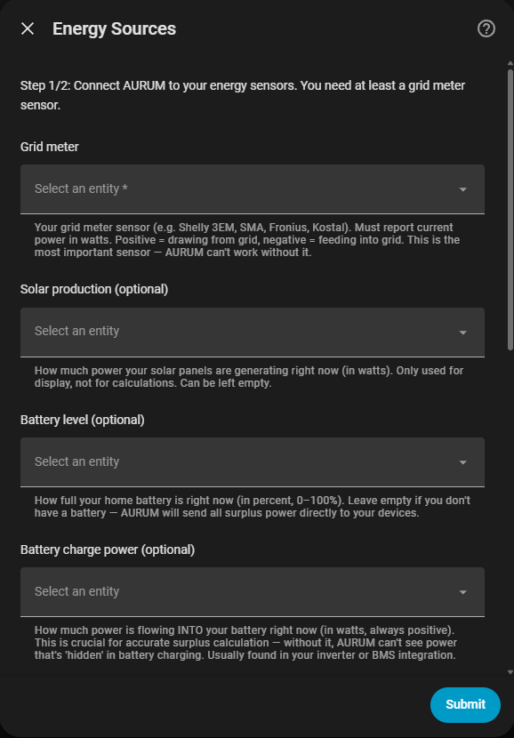
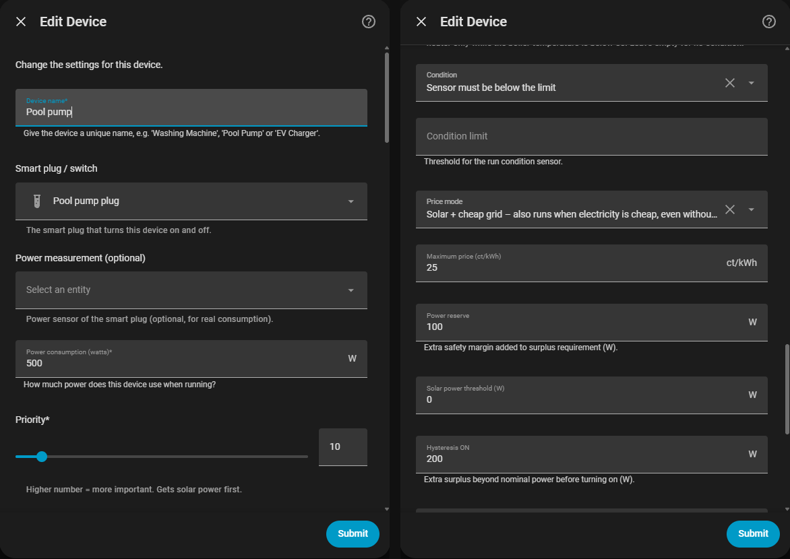

<p align="center">
  
</p>

<h3 align="center">Run your washing machine, dishwasher, pool pump and water heater on solar surplus.<br>Press Start whenever you like. AURUM waits for the sun.</h3>

<p align="center">
  <a href="https://my.home-assistant.io/redirect/marketplace_repository/?owner=cm-makes&repository=aurum-ha&category=integration"></a>
  <a href="https://github.com/cm-makes/aurum-ha/releases"></a>
  <a href="https://opensource.org/licenses/MIT"></a>
  <a href="https://www.home-assistant.io/"></a>
  <a href="https://github.com/cm-makes/aurum-ha/stargazers"></a>
</p>

<p align="center">
  <a href="https://www.buymeacoffee.com/cmmakes">
    
  </a>
  &nbsp;&nbsp;
  <a href="https://github.com/sponsors/cm-makes">
    
  </a>
</p>

---

**AURUM** (*Latin: Gold*) runs the devices in your house on solar surplus: washing machine, dishwasher, pool pump, water heater, heating rod. Anything on a smart plug or relay. Press Start on the washer in the morning: with a power-metering plug, AURUM holds the program until the sun delivers. Need it done by 18:00? Switch on *Must run today*, and AURUM starts it on grid in time if the sun doesn't come.

> **No coding required.** Install AURUM from the Home Assistant Marketplace, pick your grid meter, add your devices in the UI — done.
>
> **What AURUM doesn't do:** charge electric cars, or control your battery or inverter. It reads your grid meter (and your battery level, if you have one) and switches plugs and relays.

<p align="center">
  <a href="https://my.home-assistant.io/redirect/marketplace_repository/?owner=cm-makes&repository=aurum-ha&category=integration"></a>
</p>

<p align="center">
  
  <br>
  <em>Built-in AURUM sidebar panel: the Advisor banner, live energy chips, and one card per device</em>
</p>

---

## Why AURUM?

- **Press Start, AURUM waits for the sun.** Load the washer or dishwasher and press Start whenever it suits you. With a plug that measures power, AURUM notices the start, holds the program until there is surplus, then switches the plug back on. The appliance has to resume its program when power returns. Once the program runs, AURUM doesn't cut it, not even when the battery reaches its minimum.
- **Done by the time you need it.** Switch on *Must run today* and set a deadline. If the sun doesn't deliver, AURUM starts the device on grid just in time. This works for the pool pump and the water heater too, sized to the runtime you set.
- **For the devices you already have.** Pool pump, water heater, heating rod, IR heaters: anything behind a switchable plug or relay. AURUM switches them on surplus, highest priority first, and off again when the surplus drops. A run condition such as *tank below 55 °C* stops the water heater once the tank is hot.
- **It tells you why.** A banner in the panel and the *Current decision* sensor say in plain words why each device is running, waiting or off: waiting for surplus, battery below reserve, run condition not met.
- **Battery, forecast and price, if you have them.** Let the battery charge first, use the Solcast or Open-Meteo forecast so it still reaches its target, and use cheap hours from Tibber, Nordpool, aWATTar or EPEX Spot when the sun isn't enough.
- **Small and simple.** A handful of entities per device, one panel, no YAML, no blueprints, no extra cards. It's a regular integration, not an add-on, so it runs on every Home Assistant installation type.

<details>
<summary>🇩🇪 <b>Kurz auf Deutsch</b></summary>

<br>

AURUM lässt Waschmaschine, Spülmaschine, Poolpumpe und Warmwasser-Boiler mit deinem PV-Überschuss laufen. Alles, was an einer schaltbaren Steckdose oder einem Relais hängt.

- **Start drücken, AURUM wartet auf die Sonne:** Mit einer Steckdose, die die Leistung misst, erkennt AURUM, wenn du Start drückst, und hält das Programm an, bis genug Sonne da ist. Das Gerät muss sein Programm fortsetzen, wenn der Strom zurückkommt. Läuft das Programm, unterbricht AURUM es nicht mehr, auch nicht, wenn die Batterie ihren Mindest-Ladestand erreicht.
- **Pünktlich fertig:** Mit *Muss heute* und *Fertig bis* startet AURUM notfalls rechtzeitig mit Netzstrom. Das geht auch für Poolpumpe und Boiler.
- **Einrichtung komplett in der Oberfläche:** Netzzähler auswählen, Geräte anlegen, Prioritäten setzen. Kein YAML.
- **Batterie zuerst, wenn du willst:** Mindest-Ladestand pro Gerät, Batterie-Vorrang und PV-Prognose (Solcast, Open-Meteo), damit die Batterie ihr Ladeziel trotzdem erreicht.
- **Dynamische Stromtarife:** Geräte laufen auf Wunsch auch bei günstigem Netzstrom (Tibber, Nordpool, aWATTar, EPEX Spot).
- **Erklärt jede Entscheidung:** Das Panel und der Sensor *Current Decision* zeigen, warum ein Gerät läuft, wartet oder aus ist.
- **Nicht dabei:** E-Auto laden, Batterie oder Wechselrichter steuern. AURUM liest den Netzzähler (und den Akkustand) und schaltet Steckdosen und Relais.
- Oberfläche und Dashboard auf Deutsch und Englisch.

Installation ab Home Assistant 2026.11: **Einstellungen → Marketplace**, nach **AURUM** suchen, **Installieren**. Fragen kannst du gerne auch auf Deutsch in den [Discussions](https://github.com/cm-makes/aurum-ha/discussions) stellen.

</details>

---

## Highlights

| Feature | Description |
|---|---|
| **Startup Detection** | Detects washing machine / dishwasher program start, pauses until PV surplus is available, resumes automatically |
| **Must-run-today & Deadline** | Starts a device on grid just in time if the sun doesn't deliver by your deadline |
| **Built-in Dashboard** | A self-adapting **AURUM** sidebar panel ships with the integration — no YAML, no extra cards. Add or remove a device and it updates automatically |
| **PV Surplus Steering** | Turns devices on/off based on available excess power |
| **Battery Priority** | Optional: only genuine grid export counts as surplus, so the battery charges first |
| **Battery-Aware** | Respects battery SOC with configurable target and minimum thresholds |
| **Run Conditions** | Optional per-device prerequisite (a sensor below/above a limit — e.g. water heater only while the tank is below 55 °C), with an optional restart margin so it works like a thermostat |
| **PV Power Gate** | Optional per-device threshold: run on raw PV generation above a limit (with healthy SOC), bypassing the budget cap |
| **Daily Reset Hour** | Per-device reset hour for runtime counters — align a cheap-grid device to the solar day |
| **Priority-Based** | Higher priority devices get power first |
| **PV Forecast Budget** | Uses Solcast or Open-Meteo forecast to limit device runtime so the battery reliably reaches target SOC |
| **Price-Aware Scheduling** | Devices can run on cheap grid power (Tibber, Nordpool, aWATTar, EPEX Spot) — even without PV surplus |
| **Per-Device SOC Threshold** | Each device can have its own minimum battery level |
| **Energy Tracking** | Per-device kWh/day tracking, compatible with HA Energy Dashboard |
| **Push Notifications** | Optional mobile push when devices are turned on/off |
| **Manual Override** | Auto-created switch per device: AURUM hands the device back to you |
| **Hysteresis & Debounce** | Prevents rapid switching with configurable margins |
| **State Persistence** | Device runtimes, energy counters, the budget safety factor and the learned household load survive restarts |
| **HA Diagnostics** | Download a full JSON snapshot for bug reports |
| **No Vendor Lock-In** | Works with any grid meter, any battery, any smart plug, any price sensor |

---

## Requirements

- Home Assistant 2024.1.0+
- A grid power sensor (W, signed: positive = import, negative = export) — e.g. Shelly 3EM, Kostal, SMA, Fronius
- Smart switches for your devices — e.g. Shelly Plug, Tasmota, Zigbee plugs
- Optional: Battery SOC sensor, PV power sensor, Solcast or Open-Meteo forecast

---

## Installation

### Home Assistant Marketplace (2026.11 and later)

<a href="https://my.home-assistant.io/redirect/marketplace_repository/?owner=cm-makes&repository=aurum-ha&category=integration"></a>

1. Click the badge, or go to **Settings → Marketplace** and search for **AURUM**
2. Click **Install**. The setup starts right away, no restart needed

Updates appear at the top of **Settings**. After an update, a repair asks you to restart Home Assistant.

### HACS (before 2026.11)

1. Open HACS in Home Assistant
2. Search for **AURUM** and click **Download**
3. Restart Home Assistant

AURUM is listed in both the Marketplace and the HACS default store, so you don't need to add a custom repository.

### Manual

1. Copy `custom_components/aurum/` to your `config/custom_components/` directory
2. Restart Home Assistant

---

## Setup

<a href="https://my.home-assistant.io/redirect/config_flow_start/?domain=aurum"></a>

1. After a Marketplace install, the setup is already open. Otherwise click the badge, or go to **Settings → Devices & services → Add integration → AURUM**
2. **Energy Sources:** Select your grid power sensor (and optionally PV, battery SOC, battery charge/discharge power, PV forecast)
3. **Battery settings:** Set capacity, target SOC, minimum SOC, update interval and sensor timeout (see [When a sensor fails](#when-a-sensor-fails-safe-mode))
4. After setup: Go to **AURUM > Configure** to add devices

<p align="center">
  
  <br>
  <em>Setup wizard — connect your energy sensors in two steps</em>
</p>

### Adding Devices

In the integration options (Configure), click **Add a device** and fill in:

| Setting | Description |
|---------|-------------|
| **Name** | Display name (e.g. "Washing Machine") |
| **Switch entity** | The switch that controls the device |
| **Power sensor** | Optional: Real-time power measurement |
| **Nominal power** | Expected power draw in watts |
| **Priority** | 1–100, higher = turned on first |
| **SOC threshold** | Device only runs when battery is above this level |
| **Startup detection** | Enable for appliances with programs (washers, dishwashers). AURUM keeps the plug on in standby, detects when you press Start, pauses immediately, and resumes when PV surplus is sufficient. If a deadline is set and PV never arrives, AURUM starts on grid power as a fallback. |
| **Interruptible** | If disabled, AURUM will not turn the device off mid-cycle |
| **Deadline** | Time by which the device must have run (e.g. `18:00`). Only active while the device's *Must run today* switch is on. Regular devices: AURUM starts the device on grid just in time to reach *Estimated runtime* by the deadline, counting the runtime since *Must run today* was switched on (PV runs count); once that is reached, *Must run today* resets. With *Stop after runtime* the daily cap wins. With *Startup detection*, the deadline is sized for the pending program and *Must run today* resets when that program finishes. |
| **Estimated runtime** | Expected runtime in minutes (used for deadline scheduling) |
| **Run condition sensor** | Optional prerequisite: a sensor that must be **below** / **above** a limit for the device to run (e.g. water heater only while `sensor.boiler_temp` is below `55`). Blocks all start paths; an unavailable sensor fails open. |
| **Restart margin** | Optional thermostat band for the run condition, in the sensor's unit. Once the reading has reached the limit, the condition stays unmet until the reading is this far back on the allowed side: *below* `55` with margin `3` stops at 55 and allows the next start only below 52 (*above* is mirrored), so a tank at 54.9 °C does not restart the water heater. `0` = no band (default). An unavailable sensor still fails open. The band is kept across restarts and starts over when you change the sensor, the condition or the limit. |
| **Daily reset hour** | Hour (0–23) when this device's runtime counter resets. `0` = midnight (default). Set to `9` so a cheap-grid device runs on solar first during the day and only tops up its runtime from cheap grid overnight. |
| **PV power threshold** | Optional: run whenever *actual* PV generation is ≥ this many watts **and** battery SOC ≥ the device's SOC threshold, bypassing the daily budget cap. Expresses "run whenever PV ≥ 1000 W and battery ≥ 25 %" — useful when the surplus/budget logic reserves solar for the battery and a device (e.g. a pool pump) wouldn't otherwise start. Requires a PV **power** sensor. `0` = disabled (default). Also available as a live `number.aurum_{slug}_pv_power_threshold` entity and a dashboard control. |

> **Battery priority** (in *Configure → Energy & Battery*) is a global toggle:
> when enabled, only genuine grid **export** counts as surplus for devices, so
> the battery charges first, and battery **discharge** counts as a deficit, so
> a running device is shed once the battery starts feeding it (this needs the
> battery charge/discharge power sensors). Off (default) keeps the previous
> behaviour where battery-charging power may be diverted to devices.

<p align="center">
  
  <br>
  <em>Device configuration — all settings via UI, including price mode and max price. No YAML needed</em>
</p>

### PV Forecast Budget (optional)

AURUM can limit device runtimes based on how much PV energy is forecast for the rest of the day, so the battery reliably reaches its target SOC.

In **Configure > Energy & Battery**:

| Field | What to enter |
|-------|---------------|
| `pv_forecast_entity` | Sensor with **remaining** forecast for today in kWh (e.g. Solcast "Prognose verbleibende Leistung heute") |
| `pv_forecast_today_entity` | Sensor with **hourly forecast data** as attribute (e.g. Solcast "Forecast Today" with `forecast` attribute) |

> If your forecast entity only provides a daily total without hourly data, AURUM uses a fallback sunset estimate (19:00) for budget calculations.

The budget also subtracts what your household uses until sunset. AURUM learns this per hour of the day: house consumption minus AURUM's own devices, averaged over each hour. An hour uses the learned value once it has data from 3 days; until then AURUM assumes 500 W. Loads that AURUM does not switch, such as a wallbox or a heat pump, count as household load. Short loads such as a kettle count in full; only single readings beyond ±30 kW are ignored as glitches. The learned values survive restarts.

Learning needs:

- a PV **power** sensor that reports the total PV production of all PV systems in the house (every inverter, including a balcony plant). Production it doesn't see is missing from the house consumption, so the learned load would come out too low. With a hybrid inverter, use its PV (DC input) power, not its AC output: the AC output already includes the battery, which would then be counted twice.
- with a battery (any battery sensor configured), **both** the battery charge and the battery discharge power sensor. Each reports one direction only, so with just one of them the other direction goes unseen.

AURUM pauses learning while the grid meter, the PV sensor or a battery power sensor has failed, while a device that is on has no working power sensor, and while a device's switch is unavailable or missing (it may be on). The diagnostics (`budget` → `consumption_learning`) show whether learning is active and, if not, why, naming the device.

### Price-Aware Scheduling (optional)

AURUM can run devices on **cheap grid power** — even without PV surplus. Works with any electricity price sensor (Tibber, Nordpool, aWATTar, EPEX Spot, etc.).

**Step 1: Connect price sensors**

In **Configure > Energy & Battery**, set one or more of these:

| Field | What to enter | Example |
|-------|---------------|---------|
| `price_entity` | Current electricity price in ct/kWh | `sensor.tibber_aktueller_strompreis` |
| `price_level_entity` | Price level enum (very_cheap/cheap/normal/expensive/very_expensive) | `sensor.tibber_aktuelles_preisniveau` |
| `cheap_period_entity` | Binary sensor ON during cheap periods | `binary_sensor.tibber_bestpreis_zeitraum` |
| `cheap_period_starts_in_entity` | Minutes until next cheap period (for dashboard countdown) | `sensor.tibber_bestpreis_startet_in` |

> All fields are optional. You only need one price source — AURUM checks them in order: max_price threshold → cheap period → price level.

> ⚠️ **Price unit: AURUM works in ct/kWh**, the hundredth of your currency
> (cents, Rappen, öre, pence). A `price_entity` that reports a whole
> currency unit is converted automatically: per kWh (**EUR/kWh**, **€/kWh**,
> **CHF/kWh**, **GBP/kWh**, **SEK/kWh**, **NOK/kWh**, **DKK/kWh**, **PLN/kWh**,
> **CZK/kWh**, **USD/kWh**, **AUD/kWh** and a few more; e.g. the native Home
> Assistant *Tibber* integration, `0.28`) is multiplied by 100, per MWh
> (**EUR/MWh**) divided by 10. EUR/kWh has been converted since v1.15.4, the
> other currencies and MWh since 1.16.3. A sensor without a unit is used
> as-is — if it reports `0.28` instead of `28`, every price looks cheap and
> the device runs on grid around the clock. Wrap such a sensor in a template
> sensor that multiplies by 100, or leave `max_price` at `0` and rely on the
> price level / cheap period instead.
>
> Power and energy sensors are converted the same way: kW / MW are read as W,
> Wh / MWh as kWh.

**Step 2: Configure devices**

Edit a device and set:

| Setting | Description |
|---------|-------------|
| **Price mode** | *Solar only* (default), *Solar + cheap grid*, or *Solar + cheap grid (SOC-gated)* |
| **Maximum price** | Grid power only below this price (ct/kWh, or Rappen etc. per kWh). Set to 0 to use price level / cheap period instead. |

**How it works:**

A device with `cheap_grid` mode turns on when **any** of these is true:
1. PV surplus is sufficient (normal solar logic)
2. `max_price` is set and current price ≤ threshold
3. `cheap_period_entity` is ON (best price window active)
4. `price_level_entity` is `very_cheap` or `cheap`

Debounce timers still apply to prevent flapping on price edges.

A price-based start (2–4) is independent of the daily PV budget: the budget
reserves *solar* for battery charging, and a cheap-grid run uses grid, so an
exhausted budget — including the always-zero budget after sunset — never
blocks it. (Before 1.15.1 it did, unless the device's own `soc_threshold`
happened to be above the current SOC.)

**`cheap_grid` vs. `cheap_grid_soc`:** in plain `cheap_grid`, conditions 2–4
start the device regardless of battery SOC — the device's `soc_threshold` is
never consulted on the price path. That is the right behaviour for a load
that should always take cheap grid power (a water heater, say), but it means
a device can run on grid all night while the battery sits below the reserve
you configured for it.

`cheap_grid_soc` behaves identically **except** that the price-based start is
only granted while battery SOC is at or above that device's `soc_threshold`.
Below the threshold the device falls back to solar-only behaviour: genuine PV
surplus (grid export) can still run it, a cheap price alone cannot. Set a
device to `cheap_grid_soc` when you want price-awareness *and* a battery
floor; leave it on `cheap_grid` when price should always win.

**Works with:**
- [Tibber Prices](https://github.com/jpawlowski/hass.tibber_prices) — provides best price periods, countdown, price levels (recommended over the native Tibber integration, which only supplies a price sensor, in EUR/kWh)
- [Nordpool](https://github.com/custom-components/nordpool) — price sensor + price level
- [aWATTar](https://github.com/home-assistant-libs/awattar) — hourly price data
- [EPEX Spot](https://github.com/mampfes/hacs_epex_spot) — day-ahead prices
- [Innostrom](https://github.com/LukasSkywalker/ha-innostrom) — Swiss dynamic tariffs (AEW, Swisspower and others), price sensor in CHF/kWh
- Any sensor providing a price per kWh (or MWh) or price levels

---

## Real-World Results

Running on a 10 kWp system with 5 kWh battery, managing IR heaters, a washing machine, and a dishwasher — with typical spring sun, AURUM achieves **near-100% self-consumption** and **minimal grid import** during daylight hours. On cheap-tariff nights (Tibber), the heaters pre-heat rooms using low-cost grid power.

---

## How It Works

```
Every 15 seconds:
  1. Read grid power -> calculate excess (negative grid = export = surplus)
  2. Check battery SOC -> determine mode (normal / low_soc / charging)
  3. Optional: Calculate PV budget from forecast
  4. Optional: Read electricity price -> determine if cheap period active
  5. For each device (by priority):
     - Cheap grid mode + price OK? -> Turn ON (even without surplus)
       (cheap_grid_soc: only while SOC >= the device soc_threshold)
     - Enough surplus + SOC OK + budget available? -> Turn ON
     - Surplus gone or SOC low? -> Turn OFF (respecting min-on-time)
  6. Startup Detection: If a washing machine starts -> protect the cycle
  7. Track energy (Wh) and runtime per device
```

### Battery Modes

| Mode | Condition | Effect |
|------|-----------|--------|
| **normal** | SOC >= target | All devices allowed |
| **low_soc** | min < SOC < target | Devices run if surplus is sufficient; per-device SOC thresholds apply |
| **charging** | SOC <= min | All devices off (battery protection) |

### When a sensor fails (safe mode)

A meter that drops out or freezes must not leave devices running on grid power. AURUM checks its inputs on every cycle and switches to a defined safe state per input:

| Input fails | What AURUM does |
|---|---|
| **Grid meter**: unavailable for more than about a minute, or frozen (no new reading within *Sensor timeout*, default 10 min). A configured **battery power** sensor: unavailable for more than about a minute | Starts nothing on surplus. Devices AURUM started on surplus are switched off after their *Debounce OFF* time. Running programs (startup detection), deadline jobs, cheap-grid runs, PV-gate runs and devices you switched on yourself keep running; cheap-grid and deadline starts still happen. |
| **Battery SOC**: unavailable for more than 30 min, or not reported yet after a restart | New starts of devices with a SOC threshold above 0 % treat the battery as low: only genuine grid export, no `cheap_grid_soc` grant, no PV gate. No battery-reserve emergency, and running devices are not switched off because of the SOC. |
| **PV power**: unavailable, or frozen above 0 W | Counts as 0 W, so the solar power threshold (PV gate) stays closed. |
| **Price** sensors: no data for 30 min | The price counts as not cheap: cheap-grid runs end and none start. Shorter gaps keep the current state. |
| A device's **switch**: unavailable, or the entity is missing | No commands, no power reserved, no runtime counted; startup detection pauses. Shown as `unavailable` with reason `switch_unavailable`. When the switch reports again, AURUM checks it: off means the run has ended. A switch in state `unknown` counts as off and is still commanded, as before. |
| A startup-detection device's **power sensor**: unavailable | No new program is detected, and a running program is not marked finished (only *Max runtime* can end it meanwhile). Quiet time before the gap does not count: a finish needs *Finish time* of observed power below the *Finish threshold*. |

Details:
- A single missed reading is bridged with the last value. `nan` and `inf` count as unavailable.
- While the grid meter, a battery power sensor or the SOC has failed, the Advisor shows `input_fault` (*Sensor fault – safe mode*). Every failed input, PV included, is listed in its `input_faults` attribute, and AURUM's own sensor for that input is `unavailable`. *House consumption* counts a PV sensor that is offline (inverter asleep) as 0 W, and goes unavailable only when PV is frozen or the grid exports while PV is offline. After 15 minutes Home Assistant also shows a repair issue for the grid meter, a battery power sensor or the SOC (*Settings → System → Repairs*); it clears itself when the sensor reports again. A failed PV sensor gets no repair issue, because many inverters take it offline every night.
- *Sensor timeout* applies to the grid and PV power sensors. A reading at 0 W is not age-checked, because zero-export inverters and PV at night legitimately sit at 0 W for hours, so a meter that freezes at exactly 0 W is not detected. If your meter normally updates less often than every 10 minutes (some cloud integrations), raise the timeout above its update interval, or set it to 0 to turn this check off. Otherwise surplus starts pause between updates, and when the gap is longer than *Sensor timeout* plus *Debounce OFF*, devices running on surplus are switched off and on again with every update. An unavailable sensor is always detected.
- At startup AURUM waits for the grid meter and the SOC sensor, up to 5 minutes, before it controls devices.
- After a restart, a device you switched on yourself stays yours (`manual_override`); AURUM takes over only devices it had started, or devices it has no saved state for (newly added or renamed).

### Manual Override vs. Manually-On

| Situation | AURUM behavior |
|-----------|---------------|
| Override switch **ON** | AURUM never switches the device — no turn-on, no turn-off |
| Device physically on, override switch **OFF** | AURUM applies normal turn-off logic (e.g. battery protection) |
| AURUM turned the device on | Full management — turns off when surplus drops |

With *Startup detection* and a power sensor, AURUM keeps reading the power while the override is on. A program you run meanwhile shows as `running` (reason `running`) and its end is detected as usual. If you switch the plug off while the program is drawing power, the program is interrupted, not finished: the off time counts neither as runtime nor toward *Finish time*, only *Max runtime* can end it meanwhile, and the same program continues when you switch the plug back on. If the power was already below the *Finish threshold* at AURUM's last reading, for example because the program had ended and you unplugged it after unloading, the off time counts toward *Finish time* (but not as runtime), so the end is detected as usual. AURUM reads it the same way when you pause the program at the appliance and then switch the plug off: unless you switch the plug back on and resume within *Finish time*, the program counts as finished. The *finished* message reports the runtime AURUM counted for the program, without the time the plug was off under the override. When you switch the override off, a program AURUM has seen running under the override runs to its end untouched. AURUM has seen it once it has drawn more than the *Start threshold* for the *Detection time*. That takes at least two readings. AURUM reads the devices every second update cycle (every 30 s with the default 15 s update interval), so allow up to a minute before you switch the override off. This also works while the battery is at its reserve. A program you start or resume just before switching the override off is handled like any program start: AURUM pauses it until there is surplus. A paused program that isn't drawing power stays paused until there is surplus. Without a power sensor AURUM can't tell a program from standby, so it adopts no program under the override.

---

## Entities Created

### Global
| Entity | Type | Description |
|--------|------|-------------|
| `sensor.aurum_excess_power` | Sensor | Available surplus (W) |
| `sensor.aurum_grid_power` | Sensor | Grid power (W, positive = import) |
| `sensor.aurum_pv_power` | Sensor | PV production (W) |
| `sensor.aurum_house_consumption` | Sensor | House consumption (W) |
| `sensor.aurum_battery_soc` | Sensor | Battery SOC (%) |
| `sensor.aurum_battery_mode` | Sensor | Current mode (normal/low_soc/charging) |
| `sensor.aurum_battery_charge` | Sensor | Battery charge power (W) |
| `sensor.aurum_battery_discharge` | Sensor | Battery discharge power (W) |
| `sensor.aurum_electricity_price` | Sensor | Current electricity price (ct/kWh) with price_level, cheap_period, cheap_period_starts_in_min attributes |
| `sensor.aurum_forecast_remaining` | Sensor | PV forecast remaining today (kWh) |
| `sensor.aurum_budget` | Sensor | Device power budget (W) |
| `sensor.aurum_safety_factor` | Sensor | Budget safety factor (%) |
| `sensor.aurum_energy_today` | Sensor | Total energy all devices today (Wh) |
| `sensor.aurum_current_decision` | Sensor | What AURUM is doing right now, and why — see [The Advisor](#the-advisor-current-decision) |
| `sensor.aurum_cycle` | Sensor | Update cycle counter (diagnostic) |
| `number.aurum_target_soc` | Number | Target SOC slider |
| `number.aurum_min_soc` | Number | Minimum SOC slider |

### Per Device
| Entity | Type | Description |
|--------|------|-------------|
| `sensor.aurum_{slug}` | Sensor | Device state (on/off/manual_override/running/standby/waiting/done). For price-aware devices (cheap_grid, cheap_grid_soc): includes scheduling_reason, price_mode, cheap_period, starts_in attributes |
| `sensor.aurum_{slug}_power` | Sensor | Current power draw (W) |
| `sensor.aurum_{slug}_runtime` | Sensor | Runtime today (min) |
| `sensor.aurum_{slug}_energy_today` | Sensor | Energy consumed today (Wh, TOTAL_INCREASING — HA Energy Dashboard compatible) |
| `binary_sensor.aurum_{slug}_active` | Binary | Is device active? |
| `number.aurum_{slug}_soc_threshold` | Number | SOC threshold slider |
| `switch.aurum_{slug}_override` | Switch | Manual override (AURUM hands off) |
| `switch.aurum_{slug}_muss_heute` | Switch | Force device on today |
| `switch.aurum_{slug}_disable` | Switch | Force-off: removes the device from control and keeps it off |

> `{slug}` is the device name lowercased with spaces replaced by underscores (e.g. "Washing Machine" -> `washing_machine`).

---

## Dashboard

AURUM ships with its own **dashboard panel** — nothing to install or configure.
After setup, an **AURUM** entry (☀️) appears in the Home Assistant sidebar. It
renders live from AURUM's own entities and adapts automatically: add or remove a
device in the options and its card appears or disappears.

It shows a **decision banner** up top (what AURUM is doing right now — see
[The Advisor](#the-advisor-current-decision)), overview chips (PV, grid
import/export, battery SOC, surplus, budget, house consumption, remaining
forecast, cheap-grid flag) and one card per device with a **PV | Manual | Off**
mode selector, a *Must-run-today* toggle, a translated reason line ("→ solar
surplus", "→ waiting for program start"), and the SOC-threshold, max-price,
PV-power-threshold and deadline controls. It follows your HA theme and is
localized (English by default, German when the HA UI is set to German).

Renaming the AURUM device, or the entity IDs of its hub sensors (for example
with *Recreate entity IDs*), does not break the panel. Leave the per-device
entity IDs (`sensor.aurum_<device>…`, `switch.aurum_<device>_…`) as they are:
AURUM builds them from the device name. If *Recreate entity IDs* changes them,
AURUM renames them back on the next start.

> The sidebar entry is sorted alphabetically — if your sidebar is long, scroll
> down or pin it to the top via *Profile → Edit sidebar*.

**Optional (legacy):** a manual Mushroom-based dashboard is still available as
**[example_dashboard.yaml](example_dashboard.yaml)** for users who prefer a
Lovelace dashboard (requires [Mushroom Cards](https://github.com/piitaya/lovelace-mushroom) via HACS).

---

## The Advisor: Current Decision

`sensor.aurum_current_decision` answers the most common question about any
automatic optimizer: **"Why is AURUM (not) running my device right now?"**
Zero configuration — it's always active.

### Sensor state (localized EN/DE)

| Code | Meaning |
|------|---------|
| `running_solar` | At least one device is running on PV surplus |
| `running_cheap_grid` | Running because electricity is cheap |
| `running` | Running for another reason (manual override, deadline) |
| `waiting` | Devices configured, none running — waiting for surplus |
| `battery_charging` | Battery below your `min_soc` reserve — devices paused |
| `input_fault` | A sensor AURUM needs has failed — safe mode (see [When a sensor fails](#when-a-sensor-fails-safe-mode)); the failed inputs are in the `input_faults` attribute |
| `startup` | Sensor warm-up after a restart (~90 s, up to 5 min while the grid or SOC sensor is not reporting) |
| `idle` | No devices configured |

### Per-device reasons (attributes)

The `devices` attribute lists every device with a machine-readable `reason`:

| Reason | Meaning |
|--------|---------|
| `solar_surplus` | Running on PV surplus |
| `solar_pv` | Running via the raw-PV gate (`pv_power_threshold`) |
| `cheap_grid` | Running on cheap grid power |
| `manual_override` | You took over — AURUM hands off |
| `running` | Running, but not for surplus, cheap power or a deadline (e.g. a program you ran under Manual override) |
| `forced_deadline` | Deadline start (must finish today) |
| `runtime_done` / `program_done` | Done for today |
| `program_standby` | Waiting for you to start a program (washer/dishwasher) |
| `program_paused` | Program paused, waiting for surplus to resume |
| `battery_charging` | Battery below reserve |
| `below_soc_threshold` | Battery below this device's SOC threshold |
| `condition_not_met` | Run condition blocks it (e.g. boiler already hot, or still inside the restart margin) |
| `disabled` | Force-off switch is on |
| `switch_unavailable` | The device's switch is unavailable — AURUM sends it nothing until it reports again |
| `input_fault` | Waiting because the surplus or the SOC is unknown (sensor failure) |
| `waiting_surplus` | Not enough surplus right now |

> Reason codes in attributes are untranslated by design (HA only translates
> entity states). The AURUM panel shows them translated; in your own cards
> you see the codes.

### Use it in your own dashboard

```yaml
type: markdown
content: >
  ## {{ states('sensor.aurum_current_decision') }}
  
  - **{{ d.name }}**: {{ d.state }} → {{ d.reason }}
  
```

### Use it in automations

```yaml
# Push notification when the battery drops below reserve
trigger:
  - platform: state
    entity_id: sensor.aurum_current_decision
    to: battery_charging

# Condition: has the washing machine finished its program today?
condition: >
  {{ state_attr('sensor.aurum_current_decision', 'devices')
     | selectattr('slug', 'eq', 'washing_machine')
     | map(attribute='reason') | first == 'program_done' }}
```

The attributes deliberately contain no fast-changing numbers (no watts, no
timestamps), so the sensor produces clean state history and won't bloat your
recorder database. Live power values live in the dedicated numeric sensors.

---

## Diagnostics

Download a full JSON snapshot of AURUM's internal state for troubleshooting:

**Settings > Devices & Services > AURUM > Download Diagnostics**

The file contains: energy values, battery state, budget info (including the learned household load and why its learning is paused, if it is), device states, override switch states, and coordinator health.

---

## Roadmap

- [x] Price-aware scheduling (Tibber, Nordpool, aWATTar, EPEX Spot)
- [x] Per-device energy tracking (kWh/day)
- [x] Push notifications (mobile app)
- [x] Built-in dashboard panel (auto-adapting AURUM sidebar view)
- [x] Battery-priority surplus mode
- [x] Per-device run conditions (sensor prerequisite)
- [x] Per-device daily reset hour
- [x] Advisor: "Current Decision" sensor explaining what AURUM does and why
- [x] SOC-gated cheap-grid price mode
- [ ] Cost tracking (import/export/autarky per device)
- [ ] Multi-battery support

---

## Support the Project

If AURUM saves you energy and money, consider supporting its development:

<p align="center">
  <a href="https://www.buymeacoffee.com/cmmakes">
    
  </a>
</p>

<p align="center">
  <a href="https://github.com/sponsors/cm-makes">
    
  </a>
</p>

Your support helps keep this project alive and growing.

---

## Troubleshooting

### Start here: ask AURUM what it's doing

Before working through the symptoms below, look at **`sensor.aurum_current_decision`** — or the banner at the top of the AURUM panel. It answers *"why is (not) this device running right now?"* for every device, in plain language, with no configuration:

```
Waiting for surplus · 0/3 active
  Pool pump      → below battery threshold
  Water heater   → waiting for surplus
  Dishwasher     → waiting for program start
```

Most "it doesn't work" reports turn out to be AURUM working correctly and saying so — a battery below the device threshold, a run condition that isn't met, a daily runtime already used up. See [The Advisor](#the-advisor-current-decision) for every reason code and what it means.

If the decision genuinely doesn't match what you expected, that's worth an [issue](https://github.com/cm-makes/aurum-ha/issues) — include the sensor's attributes and we can see exactly what AURUM saw.

### Then check these patterns

Most remaining setup issues fall into one of these. Before opening an issue, check whether your symptom matches.

### Advisor says *Sensor fault – safe mode*

One of AURUM's input sensors is unavailable or has stopped reporting new values. The `input_faults` attribute of `sensor.aurum_current_decision` names it, and *Settings → System → Repairs* shows it after 15 minutes. Check the device or integration behind that sensor. If it is a slow cloud meter that only updates every 10–15 minutes, raise *Sensor timeout* in *Configure → Energy & Battery*, or set it to 0. See [When a sensor fails](#when-a-sensor-fails-safe-mode) for what AURUM does meanwhile.

### `sensor.aurum_excess_power` is always 0 (or always huge) — devices never react

**Grid sign convention is wrong.** AURUM expects: positive grid power = drawing from grid, negative = feeding in. Many inverters report this the other way around (or only positive values).

Quick test: with PV producing more than house consumption, your grid sensor should read **negative**. If it's positive while you're exporting, create a Template sensor that flips the sign:

```yaml
template:
  - sensor:
      - name: "Grid Power Signed"
        unit_of_measurement: "W"
        device_class: power
        state_class: measurement
        state: "{{ -1 * states('sensor.your_grid_sensor') | float }}"
        availability: "{{ has_value('sensor.your_grid_sensor') }}"
```

Then point AURUM at `sensor.grid_power_signed`. The `availability` line keeps a meter outage visible as `unavailable`, so AURUM can go into safe mode; `float(0)` would turn the outage into a live-looking 0 W.

### Battery mode stuck on `charging`, all devices off

Two possible causes:

1. **Battery SOC sensor below `min_soc`** — check `sensor.aurum_battery_soc` vs. the **Battery reserve** slider. If SOC is reported as e.g. `42` but you expected `42%`, you're fine. If it's `0.42`, your sensor reports a fraction — AURUM's config flow now catches this at setup, but old configs won't be re-validated. Replace with a Template sensor that multiplies by 100.
2. **An unavailable SOC sensor is no longer a cause.** Up to 1.15 a SOC sensor that was still unavailable after a restart was read as 0 % and forced charging mode. Since 1.16 the Advisor shows *Sensor fault* instead (see [When a sensor fails](#when-a-sensor-fails-safe-mode)). Without a battery SOC sensor configured, AURUM runs without battery logic (mode `normal`).

### Surplus seems too low when the sun is bright

You probably have a battery but didn't configure **Battery charge power** and **Battery discharge power**. Without these, AURUM can't tell how much PV power is "hidden" in battery charging, so it underestimates the real surplus available for devices. Both sensors live in your inverter/BMS integration (Solax, SMA, Fronius, Kostal usually expose them).

### Device shows as `waiting` even though there's surplus

Open the device entity and check:

- **Priority** — lower-priority devices wait while higher-priority ones get power first
- **SOC threshold** — device won't run if battery is below this level (during `low_soc` mode)
- **Hysteresis ON** — AURUM needs `nominal_power + hysteresis_on` of surplus before turning on, to avoid flapping
- **Debounce ON** — surplus must stay sufficient for this many seconds before AURUM commits

For diagnostic detail, look at the device entity's `scheduling_reason` attribute.

### Devices keep flapping (on/off/on/off)

Increase `hysteresis_off` (tolerate larger surplus dips before turning off) and `debounce_off` (let the device ride through short clouds). Defaults are 100W / 600s — for shaded sites, try 200W / 900s.

### Still stuck?

Download diagnostics (**Settings → Devices & Services → AURUM → ⋮ → Download diagnostics**) and open an issue with that file attached. It contains every value the maintainer needs to debug.

---

## Support & Community

Got a question, an idea, or want to show off your setup? Use GitHub Discussions — it's the fastest way to get help and talk to other users.

| | |
|---|---|
| [Ask a question](https://github.com/cm-makes/aurum-ha/discussions/categories/q-a) | Setup help, configuration, troubleshooting |
| [Share an idea](https://github.com/cm-makes/aurum-ha/discussions/categories/ideas) | Feature ideas — discuss before opening a formal request |
| [Show and tell](https://github.com/cm-makes/aurum-ha/discussions/categories/show-and-tell) | Dashboards, setups, energy results |
| [Home Assistant forum](https://community.home-assistant.io/t/aurum-solar-surplus-optimizer-hacs-integration/1000274) | Release news and other users' setups |
| [Report a bug](https://github.com/cm-makes/aurum-ha/issues/new?template=bug_report.yml) | Something broken? Open an issue |

---

## Contributing

Contributions are welcome! See [CONTRIBUTING.md](CONTRIBUTING.md) for guidelines.

## License

MIT License — see [LICENSE](LICENSE)

## Changelog

See [CHANGELOG.md](CHANGELOG.md) for version history.
